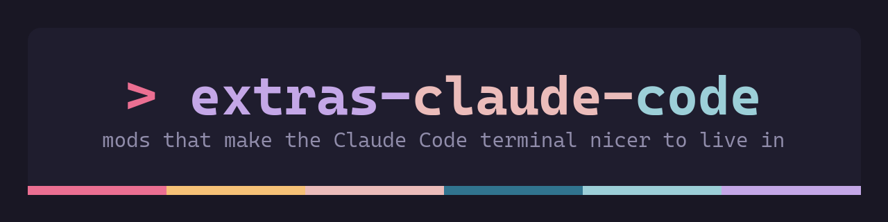
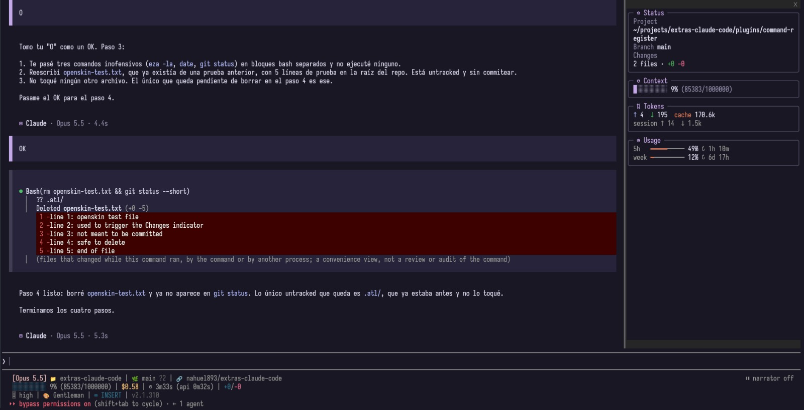

<p align="center"></p>

# extras-claude-code

Mods for [Claude Code](https://claude.com/claude-code) that make its terminal interface nicer to live in. Each one installs on its own.



## The mods

### [openskin](plugins/openskin): a new look and a status panel

- **OpenCode-style transcript**: your prompts and tool calls in barred blocks, Claude's replies on a band of their own, framed shell commands, and a `▣ Claude · model · time` footer on every turn.
- **Status panel** beside the transcript in fullscreen (`/panel` opens it anywhere), made of cards:
  - **✿ Status**: directory, branch, uncommitted changes, and your status line's output.
  - **◔ Context**: a colored bar showing how full the context window is.
  - **⇅ Tokens**: the last turn's tokens and the session total.
  - **◷ Usage**: the 5-hour and weekly subscription windows.
  - **≡ Board** and **¶ Summary**, when the mods below are installed.
- **Themes with `/skin`**: ten presets (Tokyo Night, Catppuccin Mocha and Latte, Gruvbox, Nord, Rose Pine and Dawn, Kanagawa, Everforest, One Dark), plus the default. Every color is also an option, including the panel background.
- **Follows your desktop**: when a script changes the colors in `settings.json`, open sessions pick them up within seconds.

### [command-register](plugins/command-register): copy commands without the mouse

- Every shell command Claude gives goes into a numbered register.
- **`/cc`** lists them above the prompt, and a digit copies one. **`/cc <n>`** copies command n directly.

### [board](plugins/board): what is done, pending and waiting on you

- **`/board`** asks a model (Haiku by default) to rewrite the session's board from the conversation: done `✓`, pending `○`, and waiting on your decision `◇`.
- One board per session, kept in a file under the project (`~/.cache/extras-claude-code/projects/<project slug>/<session id>/board.md`), and shown in the openskin panel.

### [summarize](plugins/summarize): the session in a few lines

- **`/summ`** asks a model (Haiku by default) for a short summary of the session: the goal, what happened, the decisions, and where it stands.
- One summary per session, kept next to its board (`.../<session id>/summary.md`), and shown in the openskin panel.

Each mod installs on its own and works without the others. board and summarize only add cards to the panel when openskin is there.

Unofficial: not affiliated with Anthropic or OpenCode.

## Install

Add the marketplace once, at the prompt of a Claude Code terminal session:

```
/plugin marketplace add nahuel893/extras-claude-code
```

Then install the mods you want:

```
/plugin install openskin@extras-claude-code
/plugin install command-register@extras-claude-code
/plugin install board@extras-claude-code
/plugin install summarize@extras-claude-code
```

From a shell, the same steps are `claude plugin marketplace add nahuel893/extras-claude-code` and `claude plugin install <mod>@extras-claude-code`.

Each mod's README lists its options and limits.

## Recommended

[**better-claude**](https://github.com/midudev/better-claude) by [Miguel Ángel Durán (midudev)](https://github.com/midudev) is a great collection of Claude Code mods: a prompt queue, one-turn Haiku and max-effort prefixes, token, subscription and context meters, image previews, a git snapshot of every turn, and more. Install it alongside these:

```
/plugin marketplace add midudev/better-claude
```

## Development

Each mod lives in `plugins/<mod>/` with its own tests:

```bash
cd plugins/openskin && claude plugin test . && claude plugin validate .
```

## License

MIT
