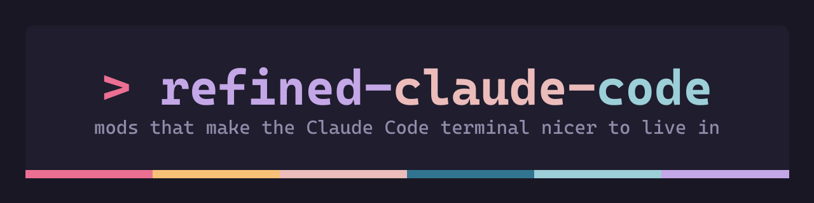

<p align="center"></p>

# refined-claude-code

**A refined terminal UI for [Claude Code](https://claude.com/claude-code)**: themes, a redesigned transcript, a live status panel and session tools. Each mod installs on its own.

- **Themes**: ten color presets (Tokyo Night, Catppuccin, Gruvbox, Nord, Rose Pine, Kanagawa, Everforest, One Dark and more), and every color is an option. Match your terminal's background to the theme ([how](plugins/openskin/README.md#match-your-terminal-background)).
- **Redesigned interface**: an OpenCode-style transcript with barred prompts and tool calls, a band for each reply and framed shell commands.
- **Status panel**: a sidebar dashboard with git status, context window, tokens, usage limits, and the session's board and summary.
- **Keyboard-first**: copy any shell command Claude gave with one digit.

<sub>Keywords: Claude Code theme, Claude Code UI, Claude Code plugins, Claude Code mods, TUI customization, terminal theme, status panel, sidebar, dashboard, color schemes, dark theme, OpenCode look.</sub>


## The mods

### [openskin](plugins/openskin): a new look and a status panel

- **OpenCode-style transcript**: your prompts and tool calls in barred blocks, Claude's replies on a band of their own, framed shell commands, and a `▣ Claude · model · time` footer on every turn.
- **Status panel** beside the transcript in fullscreen (`/panel` opens it anywhere), inspired by the side panel of [Gentle Shell](https://github.com/Gentleman-Programming/gentle-shell). It is made of cards:
  - **✿ Status**: directory, branch, uncommitted changes, and your status line's output.
  - **◔ Context**: a colored bar showing how full the context window is.
  - **⇅ Tokens**: the last turn's tokens and the session total.
  - **◷ Usage**: the 5-hour and weekly subscription windows.
  - **≡ Board** and **¶ Summary**, when the mods below are installed.
- **Themes with `/skin`**: ten presets (Tokyo Night, Catppuccin Mocha and Latte, Gruvbox, Nord, Rose Pine and Dawn, Kanagawa, Everforest, One Dark), plus the default. Every color is also an option, including the panel background.
- **Follows your desktop**: when a script changes the colors in `settings.json`, open sessions pick them up within seconds.

### [command-register](plugins/command-register): copy commands without the mouse

- Every shell command Claude gives goes into a numbered register.
- **`/cc`** lists them above the prompt, and a digit copies one. **`/cc <n>`** copies command n directly.

### [board](plugins/board): what is done, pending and waiting on you

- **`/board`** asks a model (Haiku by default) to rewrite the session's board from the conversation: done `✓`, pending `○`, and waiting on your decision `◇`.
- One board per session, kept in a file under the project (`~/.cache/refined-claude-code/projects/<project slug>/<session id>/board.md`), and shown in the openskin panel.

### [summarize](plugins/summarize): the session in a few lines

- **`/summ`** asks a model (Haiku by default) for a short summary of the session: the goal, what happened, the decisions, and where it stands.
- One summary per session, kept next to its board (`.../<session id>/summary.md`), and shown in the openskin panel.

Each mod installs on its own and works without the others. board and summarize only add cards to the panel when openskin is there.

Unofficial: not affiliated with Anthropic or OpenCode.

## Install

Add the marketplace once, at the prompt of a Claude Code terminal session:

```
/plugin marketplace add nahuel893/refined-claude-code
```

Then install the mods you want:

```
/plugin install openskin@refined-claude-code
/plugin install command-register@refined-claude-code
/plugin install board@refined-claude-code
/plugin install summarize@refined-claude-code
```

From a shell, the same steps are `claude plugin marketplace add nahuel893/refined-claude-code` and `claude plugin install <mod>@refined-claude-code`.

Each mod's README lists its options and limits.

## Recommended

[**better-claude**](https://github.com/midudev/better-claude) by [Miguel Ángel Durán (midudev)](https://github.com/midudev) is a great collection of Claude Code mods: a prompt queue, one-turn Haiku and max-effort prefixes, token, subscription and context meters, image previews, a git snapshot of every turn, and more. Install it alongside these:

```
/plugin marketplace add midudev/better-claude
```

### A natural voice for the narrator on Arch Linux

better-claude's **narrator** mod reads a summary of each turn out loud. On Linux it speaks through speech-dispatcher when it is installed, else espeak-ng, whose voice is robotic. [`scripts/narrator-piper-arch.sh`](scripts/narrator-piper-arch.sh) sets up [Piper](https://github.com/rhasspy/piper), a local neural voice, behind speech-dispatcher, so the narrator uses it with no change to the mod:

```bash
scripts/narrator-piper-arch.sh          # Argentine Spanish voice (es-ar)
scripts/narrator-piper-arch.sh en-us    # any piper-voices-<locale> package in the AUR
```

It needs the narrator installed from better-claude, and yay or paru. It installs speech-dispatcher, `piper-tts-bin` and the voice package from the AUR, then says a test sentence. Run `/reload-plugins` afterwards. When `piper-tts-bin`'s PKGBUILD carries a stale checksum for its wrapper script, the script checks the Piper binary against the PKGBUILD itself and asks before building with the checksums skipped.

## Development

Each mod lives in `plugins/<mod>/` with its own tests:

```bash
cd plugins/openskin && claude plugin test . && claude plugin validate .
```

## License

MIT
