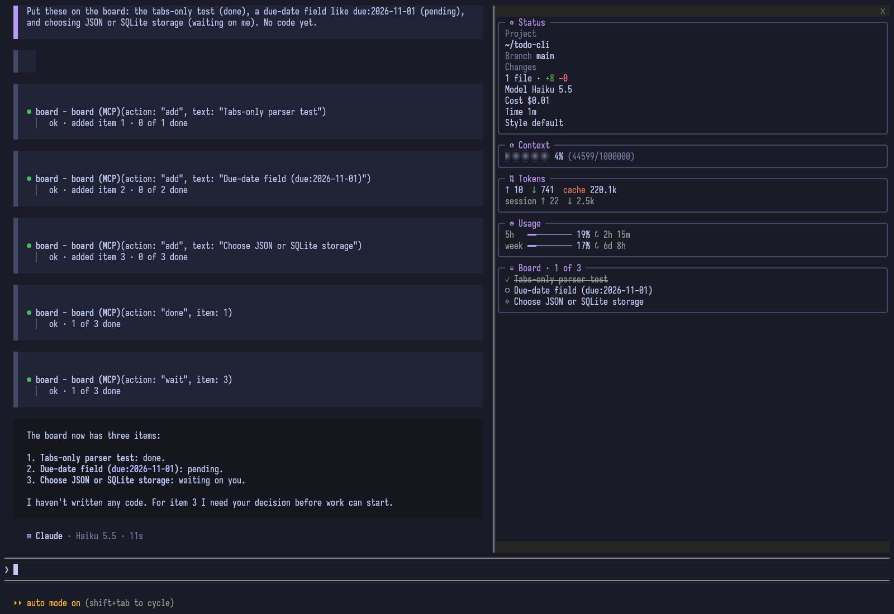

# board

A Claude Code mod that keeps a living board per session: what is done, what is pending and what
waits on your decision, pinned in a file under the project instead of buried in an old reply.

```
✓ Parser written and tested
○ Add the config loader
◇ Pick the cache directory: ~/.cache or XDG_CACHE_HOME
```

Claude keeps the board as it works, through a tool of its own. You type `/board` when you want a
model to rewrite the board from the whole conversation.



## Install

At the prompt of a Claude Code terminal session:

```
/plugin install board --marketplace nahuel893/refined-claude-code
```

Answer `y` to add the marketplace, then pick a scope (user scope loads it in every session). From a shell: `claude plugin install board --marketplace nahuel893/refined-claude-code`.

## Claude's board tool

The mod gives Claude a tool, `mcp__board__board`, that reads and writes this session's board file
directly. It has three actions:

| Action | What it does | Reply |
| --- | --- | --- |
| `add` with `text` | Appends a pending `○` item. | `ok · added item 4 · 1 of 4 done` |
| `done` with `item` | Marks item n done `✓`. | `ok · 2 of 4 done` |
| `wait` with `item` | Marks item n as waiting on you `◇`. | `ok · 2 of 4 done` |

Items are numbered from 1 in board order. The tool's description tells Claude to use it for
multi-step work, not trivial tasks: add items when it starts, mark each done as soon as it finishes,
and mark it waiting when it is blocked on you. A bad number or an empty text gets a short message
back and changes nothing.

Claude Code may list the tool behind ToolSearch, where Claude sees only its name. So each session
start hands Claude one line naming the tool and when to use it. Two more lines can come with your
prompts:

- **Reminder.** When the board has pending items and Claude has not called the tool for
  `reminderTurns` of your turns (5 by default), your next prompt carries
  `Board: 3 pending. Mark finished items done with the board tool.` The count then starts again.
- **Current list.** When the board file changed outside the tool (after `/board`, an edit by hand,
  or a resumed session), your next prompt carries the numbered list once, so Claude has the
  current numbers.

Nothing is added when nothing is pending and nothing changed. The token cost is one short line per
session start, one line per reminder, and the list only after an outside change.

### `/board` and the tool

`/board` and the tool never write over each other:

- While `/board` waits on its model, a tool call waits too, but only about 7 seconds: the engine
  gives a hook 10 seconds of its own time. If `/board` is still running then, the call writes
  nothing and replies `/board is rewriting the board, call again shortly.`
- `/board` reads the board only after the tool's writes in flight have finished.
- After a rewrite the numbers may have moved. A `done` or `wait` meant for the old board is refused
  with `The board was rewritten by /board. Current items:`, the numbered list and `Call again.` An
  `add` applies to the new board and its reply shows the new list.

## `/board`

Type `/board`. The command answers `Updating the board…` right away and the work goes on in the
background, so you can keep typing:

1. The mod reads this session's conversation: your messages and Claude's replies, text only, up to
   the last 60,000 characters or so.
2. It reads this session's previous board, if there is one. A new session starts from an empty board.
3. It asks a model to rewrite the board from both: still-valid items kept, finished ones marked done,
   new ones added, about 15 items at most, written in the language you talk to Claude in.
4. It keeps only the lines that start with a mark and writes the file.

A toast says `Board updated` when it is done, or why it was not updated (the model call failed, or
its reply held no board lines). A failed update leaves the previous board as it was.

Each line starts with one mark:

| Mark | Meaning |
| --- | --- |
| `✓` | Done |
| `○` | Pending |
| `◇` | Waiting on your decision |

## Where the board lives

One file per session, in a folder per project. The project's folder is the session's working
directory with every `/` turned into `-`, and the session's folder is its id:

```
~/.cache/refined-claude-code/projects/<slug>/<session id>/board.md
```

For a session `abc-123` in `/home/user/projects/app` that is
`~/.cache/refined-claude-code/projects/-home-user-projects-app/abc-123/board.md`. Each session keeps
its own board, and the file stays after the session ends, next to the other boards of the project.
The [summarize](../summarize) mod writes its `summary.md` in the same session folder, and the
[openskin](../openskin) mod shows both in its status panel.

Version 0.1.0 kept one board per project in `~/.cache/extras-claude-code/board/<slug>.md`. Those
files are no longer read, moved or deleted.

## Options

Change them with `/plugin configure board@refined-claude-code`.

| Option | Default | What it does |
| --- | --- | --- |
| `model` | `claude-haiku-5-5` | The model that rewrites the board: an alias such as `haiku` or a full model id. |
| `reminderTurns` | `5` | How many of your turns may pass with pending items and no board tool call before Claude is reminded in one line. |

Each `/board` update is one model call on your own Claude Code credentials. The board tool makes no
model call of its own.

## Development

```bash
claude plugin test .
claude plugin validate .
```

## License

MIT
