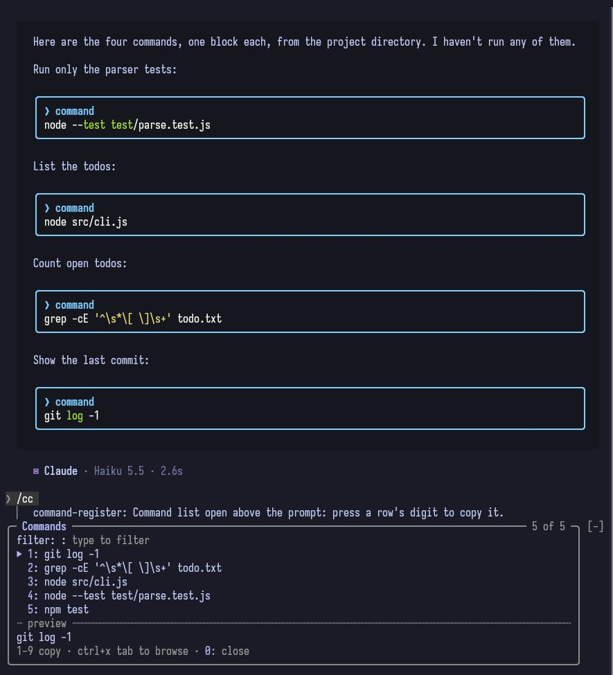

# command-register

A Claude Code mod that keeps a numbered register of every shell command Claude gives you in the
session, so you can copy one to the clipboard without selecting it with the mouse.

The mod fills the register itself by reading Claude's replies as they are stored. The model is never
asked to keep it: it costs no tokens and nothing gets forgotten.

## Install

At the prompt of a Claude Code terminal session:

```
/plugin install command-register --marketplace nahuel893/refined-claude-code
```

Answer `y` to add the marketplace, then pick a scope (user scope loads it in every session). From a shell: `claude plugin install command-register --marketplace nahuel893/refined-claude-code`.

## Usage

| You type | What happens |
| --- | --- |
| `/cc` | A list opens above the prompt, newest command first. Press a row's digit to copy that command and close the list. |
| `/cc <n>` | Copies command `n` right away, for example `/cc 3`. |



The list:

```
Copy a command: press its digit, 0 closes
1: #12  sudo systemctl restart minecraft
2: #11  journalctl -u minecraft -n 50 …
3: #10  df -h
0: close   older #1-#3: /cc <n>
```

- `1` to `9` copy that row's command. Type the digit in the empty prompt, with no focus step needed.
- To use the keyboard ring instead, press `ctrl+x tab` to focus the list, move with Tab, Shift+Tab or
  the left and right arrows, and press Enter on a row.
- `0` closes the list. So does sending your next prompt or command.
- The list shows the nine newest commands, fewer when the band above the prompt is short. Older ones
  stay in the register: copy them with `/cc <n>`.
- A row shows the command's first line, with `…` when it has more lines. The whole command is copied.

## What counts as a command

The rule is the same one the openskin mod uses to frame commands:

- a closed fenced block tagged with a shell language: `bash`, `sh`, `zsh`, `shell`, `console`,
  `fish`, `terminal` or `shellsession`;
- an untagged fence whose first non-blank line starts with `!`, `$ ` or `sudo `.

What gets copied is the block as written, with one change: a leading `$ ` on any line is removed,
because it is a prompt shown to the reader and not part of the command. A leading `!` is kept,
because it is Claude Code's own prefix for running a command at its prompt.

The register counts only commands from the main conversation, never from subagents. It starts over
after `/clear`. Replies from before a `--resume` are not counted again: a resumed transcript is
loaded, not replied.

## Keyboard shortcut

A mod cannot add keybindings. You can add these to `~/.claude/keybindings.json` yourself.

**Open the list with a key.** Claude Code's keybinding schema accepts `command:<name>` as an action,
which "executes the slash command as if typed". The binding has to be in the `Chat` context:

```json
{
  "$schema": "https://www.schemastore.org/claude-code-keybindings.json",
  "$docs": "https://code.claude.com/docs/en/keybindings",
  "bindings": [
    {
      "context": "Chat",
      "bindings": {
        "ctrl+x c": "command:cc"
      }
    }
  ]
}
```

With that binding, `ctrl+x c` and then `1` copies the newest command. `ctrl+x c` is free among the
default bindings.

**Focus the list.** Focusing the list is the built-in action `abovePrompt:focus`, bound to
`ctrl+x tab` by default in the `Chat` context. You don't need it for the digits. Rebind it only if
you want a different key for the ring.

**Optional: walk the rows with up and down.** Inside the focused band, up and down scroll it by
default, and Tab or left and right move between rows. To make up and down move between rows, add
this block. It applies to every plugin's band, not only this one:

```json
{
  "context": "AbovePrompt",
  "bindings": {
    "down": "abovePrompt:next",
    "up": "abovePrompt:previous"
  }
}
```

## Limits

- Esc does not close the list. Esc gives the keys back to the prompt, but the band above the prompt
  doesn't tell a mod when that happens. Close the list with `0` or by sending your next prompt.
- Each copy goes to the clipboard of the surface you are using. In a terminal this uses the
  machine's clipboard tool, or OSC 52 when there is none.

## License

MIT
